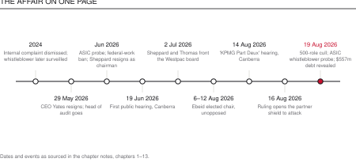

# Chapter 1 — The Original Sin

*Status: draft v0.2*

Every scandal in the Australian accounting profession traces back to a structure no one voted for and almost no one understands: the partnership. Before there was a KPMG Australia in crisis, before there was a whistleblower and a leaked board paper and a chairman's resignation, there was a nineteenth-century legal form that made the Big Four almost impossible to hold accountable.

The Partnership Act of 1892, a New South Wales statute drawn from English law, defined the partnership as a group of individuals carrying on a business in common with a view to profit. Partners were jointly and severally liable for the firm's debts. If a firm failed, its partners could lose their homes. That was the discipline — brutal, personal, and absolute.

A century later, the discipline was gone, but the form remained. What replaced unlimited personal liability was a confection of statutes and professional rules: the Professional Standards Act, state-based limited liability partnership regimes, and the mutual-holding companies that sit above the brand names. Partners stopped being exposed and started being shareholders in a corporate shell. The risk of catastrophic loss was socialised to clients and, ultimately, to the public; the profits remained private. When The Australian's black hole investigations and AFR reporting began to map this architecture, the phrase that kept recurring was "moral hazard by design."

## Regulation by moral suasion

The Wallis inquiry of the 1990s examined Australia's financial system but declined to impose meaningful structure on the accounting firms. The result was a regulatory regime that the profession itself largely wrote. Auditors were, and remain, "registered company auditors" — accredited by a professional body, CA ANZ, which also represents their commercial interests. The regulator, ASIC, holds a jurisdictional line that stops at the individual auditor's conduct, not the firm's culture. Firms regulate themselves, investigate themselves, and, as the KPMG saga would show, sometimes overrule their own investigators.

The consequences were documented long before May 2026. An AFR investigation found the Big Four had spent "two years of secrecy" resisting oversight of their partnership structures. A 2024 inquiry into the big four recommended capping partnerships at 400 members — a number Labor dodged. Senators debated reform while the firms quietly merged dozens of partnerships in an overhaul of their global structures, and reported that partners split 44 per cent of income through structures the ATO scrutinised as tax minimisation.

The moral suasion model assumed that professional pride would substitute for supervision. What it actually produced was a system in which the firm is judge, jury, and — crucially — beneficiary in its own misconduct cases. When something goes wrong, the partners who adjudicate are the same people who shared in the profits that the conduct produced.

## The partnership as a black hole

"KPMG mess part of black hole protecting partnerships," read one headline as the 2026 scandal unfolded. The metaphor was precise. A partnership has no public shareholders, no board filings, no securities regulator watching its financials, no mandatory disclosure of who decides what. Its internal documents — the investigation reports, the conduct panel findings, the board minutes — are private. When a parliamentary committee asked for them, KPMG and its lawyers refused, citing legal professional privilege. The firm, in effect, owned the record of its own misdeeds.

That is the original sin: not any single breach, but the architecture that let a breach become a cover-up. The 1892 partnership act was designed for men in a counting house. It became the legal vehicle for multi-billion-dollar global firms whose only real accountability was to themselves.

## The turning of the screw

By mid-2026, that assumption was under assault from every direction. ASIC, long criticised for timidity, launched a sweeping review of how all four major firms handle internal complaints — an inquiry made necessary by the discovery that KPMG's own complaint handling had failed so badly. The PJC — the parliamentary committee that had driven the PwC scandal into the open three years earlier — trained its attention on KPMG and found the firm's responses evasive. Senators began to speak of "systemic failure" in the regulation of the profession. The Conversation published a widely shared essay: "The brakes failed and they've crashed the car."

And for the first time, the partnership form itself was on the table. "Australia weighs break-up of Big Four accounting firms after scandals" ran the Reuters wire. Politicians floated capping partner numbers, imposing independent boards, separating audit from consulting. EY's own boss warned publicly of a "trust crisis" as big four face being split.

None of it was inevitable. A different structure — independent oversight, genuine personal liability, transparent conduct panels — might have caught the problem in March 2023, when a single audit director raised an internal complaint, rather than in May, when the CEO and the audit head resigned in front of the world.

By spring, the assault had acquired an institutional edge. The Australia Institute published the case plainly: "Light touch regulation has failed, it's time to break up the big four." Bloomberg Tax argued the KPMG scandal showed misconduct rules needed strengthening. The AFR's culture inquiry reported "pressure to cheat" inside the firms; the Crikey verdict was that "KPMG has pulled its pants down — and it could mean serious change for the Big Four." The regulator promised to publish its Big Four review findings; the parliament debated caps and rotations; and the firms, for the first time in a century, were defending the partnership's design in public rather than assuming it.

## The question this book asks

The story that follows is about what happened inside one firm in 2026. But the question it keeps returning to is the one the original sin makes unavoidable: if the structure that protects the firm also protects the misconduct, who holds the firm accountable? The answer, for a very long time, was no one. This book is about what happened when that stopped being true.

## Sources & notes

- Research: `writing/notes/ch00_general__unclassified.md` (Big Four structure, partnership caps, tax-splitting coverage); `research/evidence_map.md` (Partnership Act, Wallis inquiry, Professional Standards Act items)
- Key reported items: inquiry into capping big four partnerships at 400 (AFR); Big Four partners splitting 44% of income (ATO/AFR); "two years of secrecy" investigation (AFR); Australia weighs break-up (Reuters, Jul 2026); EY boss warns of trust crisis (The Australian)
- Spring 2026: "Light touch regulation has failed, it's time to break up the big four" (The Australia Institute, 18 Aug 2026); "KPMG Australia Scandal Shows Misconduct Rules Need Strengthening" (Bloomberg Tax, 15 Sep 2026); "KPMG culture inquiry reveals pressure to cheat" (AFR, 11 Oct 2026); "KPMG has pulled its pants down — and it could mean serious change for the Big Four" (Crikey, 18 Oct 2026); "Structural separation an 'untenable' risk to audit quality: KPMG" (Accounting Times, 3 Sep 2026)

## Open questions

- Exact terms of the Professional Standards Act caps on partner liability, and whether reform proposals survive the 2026 inquiry cycle
- How many partnerships the merged "KPMG global structure" actually comprises, and what the tax split means for any liability claims
