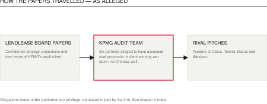

# Chapter 4 — The Lendlease Breach

*Status: draft v0.2*

The board papers of Lendlease, one of Australia's largest property and infrastructure companies, are among the most commercially sensitive documents in corporate Australia. They contain the company's strategy, its financial projections, its plans for major assets and — most valuable of all — the terms on which it is prepared to do business. KPMG Australia was Lendlease's auditor, and as auditor it had access to those papers. Under the rules of the profession, that access is strictly confidential. What the whistleblower alleged — and what KPMG would eventually admit — was that the firm had broken that confidence, using Lendlease's board papers in pitches to win work from Lendlease's rivals.

The allegation at the core of the scandal was precise. KPMG audit partners, the complaint said, had accessed confidential Lendlease board papers and used them in rival proposals involving Macquarie Group, Westpac, and Dexus. The Westpac allegation was the first to be admitted. In May 2026, the AFR reported that KPMG had admitted a partner used confidential Lendlease files in the Westpac pitch. The next day, The Australian reported that partners had been sanctioned after KPMG admitted to the "Lendlease board snoop." A partner admitted to "inappropriate access to documents in procurement of a major Westpac contract," as Accounting Times put it.

## The Westpac pitch

The Westpac contract was one of the most valuable audit mandates in Australia. Westpac had been preparing to move its external audit from PwC, and the audit pitch process — a high-stakes competition among the big four firms — was the point at which the confidential documents were used. According to the whistleblower's account and subsequent reporting, KPMG's pitch team, armed with Lendlease's board papers, set out the arguments for why KPMG could handle a bank of Westpac's size. The misuse of Lendlease data, if proven, would have given KPMG an unfair advantage not merely in the Westpac pitch but in the entire market for large-cap audit work.

The sanctions followed quickly. Three KPMG partners were sanctioned over the $32m Westpac audit pitch, the AFR reported in mid-June. The sanctioning — internal discipline rather than regulatory action — was KPMG's own admission that the conduct had occurred. It was, in the firm's own accounting, a breach of its confidentiality obligations. But the sanctioning was, for many observers, a measure of the problem rather than a solution: three partners sanctioned internally, while the firm's reputation — and the trust of its largest client — was being destroyed.

## What the board knew

The question of what KPMG's board knew, and when, became central. The whistleblower's complaint had gone to the firm's internal processes. The internal investigation had dismissed it. But the whistleblower's account, made under parliamentary privilege, alleged that the misuse was not a one-off lapse by a single partner but a pattern — that Lendlease's confidential material had been used across multiple pitches, and that the board had been kept in the dark about the extent of it.

Lendlease's own response was swift and devastating. Within days of the allegations becoming public, Lendlease announced it would review its audit relationship with KPMG. In early June, Lendlease "boots tainted KPMG auditors as ASIC probe widens," as The Australian reported. The company — which had been KPMG's client for 68 years — ended the relationship and sought a new auditor. The 68-year relationship, one of the longest-standing audit mandates in the country, was severed in weeks. Lendlease's statement to the market was blunt about the cause: the firm's conduct had breached its obligations to the client.

## The document trail

The forensic question — how had confidential board papers ended up in rival pitches? — produced the detail that turned the scandal from corporate governance into something approaching a spy story. Reports described the movement of documents, the access to Lendlease's data room, and the extent of the leak. The AFR's "KPMG audit leaks scandal – everything you need to know" assembled the timeline: the complaint in 2023, the internal investigation, the dismissal, the whistleblower's parliamentary testimony, the resignations, and the ASIC probe.

As the scope widened, the list of affected clients grew. Macquarie Group — which had a separate, multi-million-dollar audit relationship with KPMG — became the subject of the parliamentary inquiry's scrutiny. Westpac's audit chair was reported to have sat in on pitches despite conflict concerns. Dexus demanded the removal of KPMG's Eileen Hoggett from its audit. And in a separate development, the scandal spread to Telstra and Optus — confidential client information from those companies had also been misused, as Chapter 14 will detail.

## The board's response

KPMG's board response to the Lendlease breach mirrored its response to the whistleblower: initial denial, then limited admission, then a widening circle of resignations. The internal sanctions against the three partners were presented as accountability. But the resignations that followed — of the CEO, the audit head, and eventually the chairman — made clear that the board understood the Lendlease breach was not a rogue-partner problem but a failure of the firm's entire governance.

For Lendlease's shareholders, the breach raised an existential question about the audit profession. If a firm that is supposed to verify a company's accounts cannot be trusted with the confidential material it is given to do that job, what is the point of the audit at all? The answer, for Lendlease, was to leave. And as the next chapters show, it was not alone.

## The August hearing

The parliamentary hearing of Friday 14 August 2026 made the Lendlease breach its centrepiece, and drove the questioning down to the physical mechanics of the leak. Capital Brief reported that KPMG's former COO Eileen Hoggett told the hearing she couldn't remember storing Lendlease documents in a locker — a failure of recollection about the handling of the very documents whose misuse had started the scandal. The day before, the AFR reported that a screenshot and an email had raised new doubts over KPMG's account of events. Former KPMG executives, along with lawyers from Allens and Ashurst, had been listed to front the hearing, Law360 reported.

The hearing's most explosive moment came from inside the firm's own legal team. The AFR reported that a KPMG lawyer accused partners of lying to cover up the data scandal — an accusation made in a parliamentary hearing, and reported as an accusation rather than a finding, but one that went further than anything the committee had yet heard: not merely that the firm had mishandled the breach, but that its partners had deliberately lied to conceal it. The Australian judged that the hearing had unearthed the "original sins at heart of firm's cover-up."

The clients came too, and their evidence was damning. At the witness table, Westpac's Michael Ullmer — formerly Lendlease's chairman, and therefore the client whose confidential documents had been misused — told the committee he had been "twice burnt" by KPMG, and that the firm had passed Lendlease's confidential material "across the fence" to give itself an edge over rival bids. The Australian's Will Glasgow reported that Ullmer was "exasperated by the 'drip feed' of appalling details," so much so that Westpac's full board — chaired by Steven Gregg — had demanded a briefing by KPMG's local and global leadership, which then KPMG chair Martin Sheppard and departing global chair Bill Thomas fronted up to give on 2 July, weeks after the firm's first Canberra reckoning. Ullmer conceded the bank was still learning more about KPMG's breach.

Dexus's Warwick Negus was blunter still. He told the committee his firm had never been spoken to by Allens as part of KPMG's "investigation" — "Why didn't you come to talk to us?" — and said the process to appoint KPMG's new chair, Michael Ebeid, had felt "hurried." Allens' review had found KPMG partners "assumed" Dexus information would be shared between KPMG's internal and external audit teams; Negus said that was "not our expectation and it certainly is not market standard," and "stands in contrast with the assurance I've gotten from the highest level of KPMG."

Optus's John Arthur addressed what The Australian called the telco's "egregious breach" of professional responsibility: KPMG had used Optus's confidential information to pitch for the Telstra audit, after assuring the telco its teams would operate separately. "The issues in relation to Optus, I think, are crystal clear," Arthur told the committee — "an egregious breach of professional responsibilities" and "a flagrant breach of duty owed to Optus." Optus chief Stephen Rue added that the promised separation of teams "was not followed," with documents "prepared by KPMG relating to the Optus audit" having been "shared with members of the team who were bidding for the Telstra audit." An unnamed KPMG staff member, cited in the hearing, summed up the culture: "There is no such thing as a Chinese wall."

The firm's own conduct confirmed the pattern. Its deputy counsel, James McClelland, came close to tears apologising to the whistleblower and told the committee "the truth was not told in those interviews" by partners — a confirmation, from KPMG's own lawyers, that the original investigation of the Lendlease breach had been compromised. Kim Lawry, a former KPMG partner who had viewed the Lendlease documents while trying to win Westpac's $38m audit contract, was removed from that job after a photograph of a confidential Lendlease scorecard was found on her phone; Law.com reported her telling the committee "I don't know if I took the photo."

The wider architecture of conflicts also surfaced. The Australian reported that Andrew Yates had played golf with Dexus chief Darren Steinberg while KPMG was pitching for Dexus's audit, and that former Westpac director Peter Nash — once a KPMG partner — had stayed overnight at then-chair Martin Sheppard's house as Westpac chose its auditor; Ullmer told the committee Nash "did fail because that was clearly something that should not have occurred during the process." Macquarie, which had a near-$100m audit relationship with KPMG, had hired Allens — one of the firms that investigated KPMG's original claims — to scrutinise that appointment; Macquarie chair Glenn Stevens, pushed by Senators Pocock and Sharma, defended the choice while the committee called it a "rat's nest of conflicts of interest."

## The clients keep leaving

The breaches had consequences that accumulated long after the hearings ended. Lendlease had moved first, in June. In July, a Westpac director became "the latest KPMG casualty as new chair appointed" (The Australian, 1 July) — the bank's board connections to the firm being severed one appointment at a time. In September, Westpac's public posture remained studied: "KPMG client Westpac says 'trust' key to audit relationship" (The Australian, 9 September) — trust being the word every client now had to say while its advisers modelled the cost of leaving. The same month, Accounting Times reported that KPMG had "hinted at internal investigation to Westpac in 2025" — a disclosure that, if accurate, meant the firm had known of the problem more than half a year before the whistleblower went to Parliament, and had characterised it to its biggest audit client as manageable.

In October the dam broke at the top of the market. ANZ — a KPMG client for 57 years — dumped the firm and opened its audit to tender; IAG followed after 26 years. The client list that had once read as the firm's proudest asset now read as a countdown. Each departure was reported as a separate commercial event; together they were the market's verdict on the breach — delivered faster and more severely than any regulator's.

## Sources & notes

- Research: `writing/notes/ch04_the_lendlease_breach.md` (670 lines); `research/evidence_map.md`
- Key reported items: "KPMG admits partner used confidential Lendlease files in Westpac pitch" (AFR, 14 May 2026); "Partners sanctioned as KPMG admits Lendlease board snoop" (The Australian, 15 May 2026); "Three KPMG partners sanctioned over $32m Westpac audit pitch" (AFR, 18 Jun 2026); "Lendlease boots tainted KPMG auditors as ASIC probe widens" (The Australian, 5 Jun 2026); "Lendlease to change auditor as regulator probes KPMG Australia" (Straits Times, 15 Jun 2026)
- August 2026 hearing: "KPMG's former COO Eileen Hoggett can't remember storing Lendlease documents in locker" (Capital Brief, 14 Aug 2026); "Screenshot, email raise new doubts over KPMG scandal" (AFR, 13 Aug 2026); "KPMG lawyer accuses partners of lying to cover up data scandal" (AFR); "KPMG hearing unearths original sins at heart of firm's cover-up" (The Australian); "Former KPMG Execs, Allens, Ashurst To Front KPMG Hearing" (Law360, 12 Aug 2026); Westpac "drip-feeding" accusation (The Nightly; Ullmer testimony, The Australian, 14 Aug 2026); "Macquarie seeks KPMG guarantee data was not misused to win bank audit work" (Reuters/Straits Times, 13–14 Aug 2026); "Five key takeaways from parliamentary hearings into client leaks at KPMG" (Guardian, 15 Aug 2026); "'Resounding no': Clients blind to KPMG scandal" (adelaidenow)
- 14 August client testimony: Ullmer "twice burnt"/"across the fence"/"drip feed", Sheppard+Thomas 2 July briefing (The Australian "No Chinese wall", 14 Aug 2026); Dexus Negus "hurried" appointment, "no Chinese wall" staffer quote (The Australian, 14 Aug 2026); Optus Arthur "egregious breach"/"flagrant breach of duty", Rue separate-Telstra-team assurance broken (The Australian, 14 Aug 2026); McClelland "truth was not told"/"misleading, if not directly deceptive" (The Australian, 14 Aug 2026); Lawry "I don't know if I took the photo" (Law.com, 14 Aug 2026); golf between Yates and Steinberg; Peter Nash sleepover at Sheppard's (The Australian, 14 Aug 2026); Macquarie ~A$100m audit, Allens review, Pocock "rat's nest of conflicts" (The Australian, 14 Aug 2026)
- September–October 2026: "Westpac director latest KPMG casualty as new chair appointed" (The Australian, 1 Jul 2026); "KPMG client Westpac says 'trust' key to audit relationship" (The Australian, 9 Sep 2026); "KPMG hinted at internal investigation to Westpac in 2025" (Accounting Times, 10 Sep 2026); "Macquarie admits director repeatedly met KPMG figures during audit bid" (AFR, 31 Aug 2026); "Macquarie gives Hinchliffe clean chit after KPMG meetings" (Accounting Times, 9 Oct 2026); "Macquarie backs directors as KPMG audit contact gets personal" (The Australian, 6 Oct 2026); ANZ dumps KPMG after 57 years (AFR/Bloomberg/SMH/The Age/AAP, 1–2 Oct 2026); IAG dumps KPMG after 26 years, $11.6m audit (The Australian/AFR, 18 Sep 2026); "Banned and bleeding: The growing cost of the KPMG audit leaks scandal" (AFR, 28 Oct 2026)

## Open questions

- Full list of pitches in which Lendlease material was used (Macquarie, Westpac, Dexus, others?)
- The exact mechanism of document transfer — data room access, shared drives, partner communications (the 14 August hearing's locker testimony and the reported screenshot/email add fragments, but no full account)
- Whether ASIC's probe extends to the individual partners sanctioned, and what sanctions were imposed by whom (Tier 1 gap 1.3)
- Whether the allegation reported by the AFR — that a KPMG lawyer accused partners of lying to cover up the scandal — is substantiated, and whether it is taken up by ASIC or the committee
- What KPMG's 2025 "hint" to Westpac consisted of, who made it, and why it did not trigger escalation
- Who wins the ANZ tender, and whether further clients follow IAG and ANZ out the door