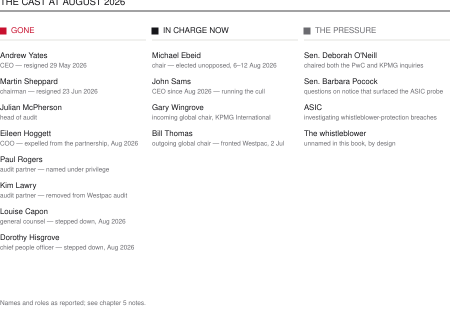

# Chapter 5 — The Cast of Characters

*Status: draft v0.2*

Every scandal is, in the end, a story about people — people who made decisions, people who looked away, and people who refused to stay silent. The KPMG affair had all three in abundance. This chapter introduces the principal figures whose lives and careers collided in 2026.

## Andrew Yates — the CEO

Andrew Yates had been KPMG Australia's CEO since 2016, a company veteran who had risen through the ranks and, in the firm's own telling, embodied its values. He had extended his term for a further three years in March 2024, at the very moment the whistleblower's complaint was being investigated internally. When the scandal broke, Yates resigned on 29 May 2026 — days after the whistleblower's allegations became public and weeks after the firm's admission of the Lendlease breach. His resignation was presented as accountability for the mishandling of the complaint, not for the underlying conduct. In his final public appearances before the committee — the "Senate reckoning" the AFR had anticipated — Yates defended the firm's processes while conceding that the outcome had been wrong.

The defining image of Yates's tenure was the contradiction at its heart: the CEO who had built the firm's "trust and integrity" brand, presiding over the discovery that the firm had surveilled its own whistleblower.

## Eileen Hoggett — the COO

Eileen Hoggett was KPMG Australia's Chief Operating Officer, the executive responsible for the firm's internal operations — including, fatefully, the handling of the whistleblower's complaint. The complaint concerned her conduct in relation to the Lendlease breach, and she was the most senior figure directly implicated in the whistleblower's allegations. Her demotion in early June 2026, and the subsequent revelations about the board's handling of her penalty, became a scandal within the scandal — the subject of Chapter 6. "Sinking feeling for Hoggett as Dexus says she's a no-go," The Australian reported, when the client demanded her removal from its audit.

## Martin Sheppard — the chairman

Martin Sheppard had been elected KPMG Australia's national chairman after a long career, and chaired the firm's Asia-Pacific operations. He was the figure around whom the "chairman's conflict" chapter revolves: the war room, the disclosure questions, the parliamentary scrutiny in camera, and the mounting pressure from figures including Mike Baird. He resigned on 23 June 2026, less than a month after the scandal broke.

## The successor's team

Michael Ebeid's authority was matched, and complicated, by the executives brought in to execute the reset. **John Sams**, appointed chief executive in August 2026, was the figure charged with the brutal arithmetic of recovery. When Sams appeared before the parliamentary committee on 14 August, The Australian reported that the firm was "a little less than 10,000" people and "in the process of shrinking further," and confirmed a week later that he had begun "conversations" with 50 partners ahead of redundancies expected to reach 450 client-facing staff. On his third day as CEO, the *Australian Financial Review* reported, Sams phoned Eileen Hoggett personally to tell her she was being expelled from the partnership — a decision Hoggett told the committee was "something that's never occurred in our firm before." Sams, a career KPMG partner, had risen internally; his pitch for the top job was built on the promise of candour the firm's previous leadership had failed to deliver.

Ebeid's chairmanship, meanwhile, was shaped by the scandal that preceded it. He was elected unopposed by the partnership in a vote running 6–12 August 2026, despite — or because of — the revelation that he had once sent Senator O'Neill a dismissive email labelling the whistleblower's allegations "completely false." As the hearing approached he apologised, calling the email, in *Capital Brief*'s account, "naive, embarrassing, wrong"; the apology was carried by *The Australian*, the *SMH*, Michael West Media and Accountants Daily. At the hearing he told the committee his first priority was the whistleblower, that "what the whistleblower wants and what the whistleblower needs" is "paramount," and that he had only just secured a first video call, "two days ago," after "several weeks of emails" to build trust. The *AFR* framed his elevation as "Michael Ebeid's last-ditch effort to save KPMG, and himself," and *The Australian* disclosed that his chair would earn around $1m a year.

Ebeid entered the role with baggage of a different kind. The Australian revealed in August that, at the same time the KPMG audit whistleblower had come forward in 2024, a separate whistleblower at Screen Australia — which Ebeid also chairs — had made formal allegations of rigged government tenders and jobs-for-mates; an external barrister found them "unsubstantiated" and the complainant's department was subsequently restructured out of existence. Ebeid had not been on KPMG's board when its own 2024 investigation ran, but his email to fellow directors defending that dismissal — "many of the statements she [O'Neill] makes are completely false" — became, in Senator Barbara Pocock's words, a "glaring insight" into his position on the whistleblower, and a liability for a chair whose legitimacy the partnership was still granting him.

Ebeid is not the only figure from 2024 whose past is being re-examined. The firm's **global leadership** — including Ebeid's predecessor as the Asia-Pacific chair, **Martin Sheppard**, and the departing global chair **Bill Thomas** — had fronted the Westpac board together on 2 July to defend a tender process in which their own conduct was later questioned. Thomas's incoming replacement, Australian **Gary Wingrove**, runs KPMG International, and the firm that had once exported Australian partners to capitals worldwide was, by August, repatriating crisis management to its home market as partners looked for exits.

## The departed senior partners

The scandal consumed more than its headline figures. By the 14 August hearing at least eight senior people had left KPMG. **Louise Capon**, the firm's general counsel, and **Dorothy Hisgrove**, its head of human resources, stood down within days of one another in mid-August — Capon's departure confirmed as the committee questioned her over an internal investigation her office had run and that the committee would not be shown. **James McClelland**, Capon's deputy, remained to testify, apologising to the whistleblower and telling the committee "the truth was not told" by partners he had interviewed.

Among the audit partners whose departures were tied to the Lendlease breach: **Julian McPherson**, the former head of audit; **Paul Rogers**, named by the whistleblower as one of the six partners who accessed rival proposals; and **Kim Lawry**, removed from Westpac's audit after a photograph of a confidential Lendlease scorecard was found on her phone — Law.com reported her telling the committee "I don't know if I took the photo." **Stan Stavros** and **Scott Guse** were present at the first public hearing in Canberra, and **Suzanne Bell** — the partner who ran the war room that won audit clients, and who was in a long-term relationship with Sheppard — was, The Australian noted, not alleged to have misused client information, even as she sat at the witness table in August. The departures read as a near-complete eviction of the firm's pre-scandal audit leadership.

## Glenn Stevens — the former governor

The scandal also reached beyond the firm's walls to one of Australia's most respected financial figures. On 12 August 2026, *The Australian* reported that former Reserve Bank governor Glenn Stevens would front MPs over the KPMG scandal; the *SMH* framed the same development as "Former RBA governor dragged into KPMG scandal." Stevens appeared before the committee to defend Macquarie's decision to hire KPMG as its next auditor, and to explain his board's choice to task Allens — one of the firms that had investigated KPMG's original whistleblower claims — with reviewing that appointment. As the *Australian Financial Review* noted, Senator Pocock called the arrangement a "rat's nest of conflicts of interest."

## The board and the law

Around the firm's leadership stood a board that had added independents — including former NSW Premier Mike Baird and veteran director Jane Hemstritch — in a governance reform that was supposed to prevent exactly this kind of scandal. Baird's testimony to the committee ("I resigned... I rued trust") and his reported pressure on Sheppard gave the board's independent members a role no one had anticipated: witnesses against the firm they were meant to oversee.

The lawyers were never far away. Ashurst and Allens — KPMG's and its partners' legal advisers — were drawn into the parliamentary hearings. The firm tapped Corrs to advise former partners embroiled in the scandal. The legal-privilege battle over the internal investigation files became one of the defining legal fronts of the affair.

## The whistleblower

The complainant herself — the former audit director — remains, as this book must respect, unnamed. She was dismissed after her internal complaint was investigated and rejected; she was surveilled; and she took her account to the Parliament, where the protection of parliamentary privilege made her allegations possible to publish. Her decision to go public, rather than to accept the dismissal, is the hinge on which the entire story turns.

## The politicians

Senator Deborah O'Neill had already made her reputation taking on PwC. The KPMG affair was her sequel. As chair of the committee that would investigate the firm, she promised — and delivered — an inquiry of extraordinary reach, summoning executives, lawyers, and auditors, and refusing to accept the firm's evasions. "I will not let this rest," she said. Her role in the PwC scandal gave her a credibility no other politician could match.

Senator Barbara Pocock (Greens) pushed the structural agenda — the break-up of the big four — that the scandal revived. The Greens' calls for a government ban on KPMG work, and their amplification of the ethics questions, kept the political pressure on.

## The journalists and the advocates

David Ross and Tansy Harcourt of The Australian, and the AFR's investigative team, broke much of the reporting this book relies on. The Centre for Public Integrity's Anthony Whealy KC supplied the "utmost integrity" language that framed the accountability arguments. Brendan Lyon, the UOW professor and whistleblower whose own lawsuit against CA ANZ tests the limited liability shield, links the KPMG story to the structural questions in Chapter 11.

## What they have in common

The cast of this book is connected by a single thread: each of them was in a position to stop the scandal, and each of them — through action or inaction — either let it happen, exposed it, or was consumed by it. The chapters that follow trace what each of them did.

## Sources & notes

- Research: `writing/notes/ch05_the_cast_of_characters.md` (1160 lines); `research/evidence_map.md`
- Key reported items: Yates resignation and Senate appearance (Reuters/AFR, May-Jun 2026); Hoggett demotion and Dexus exclusion (The Australian); Sheppard election, appointment, and resignation (KPMG, AFR, Capital Brief, 23 Jun 2026); Baird testimony ("too slow" response; The Age); O'Neill "will not let this rest" (ABC); Pocock's calls (Capital Brief)
- June 2026: KPMG partners present at the first public hearing, Canberra — Bell, Stan Stavros, Eileen Hoggett, Dorothy Hisgrove, Paul Rogers, Louise Capon, Scott Guse ("Inside the room at the Senate's KPMG grilling", The Australian, 19 Jun 2026)
- August 2026: "Macquarie, Westpac to front KPMG hearing. Ebeid new KPMG chair" (AFR, 12 Aug 2026); Ebeid apology to O'Neill — "naive, embarrassing, wrong" (Capital Brief/The Australian/Michael West Media/SMH/Accountants Daily, 10–11 Aug 2026); "Michael Ebeid's last-ditch effort to save KPMG, and himself" (AFR, 10 Aug 2026); "New KPMG chairman draws fire over dismissive whistleblower email" (hcamag); "Ex-RBA chief Glenn Stevens to front MPs over KPMG scandal" (The Australian, 12 Aug 2026); "Former RBA governor dragged into KPMG scandal" (SMH, 12 Aug 2026)
- August hearing (14 Aug): John Sams phoned Hoggett on his 3rd day to expel her / "little less than 10,000" / shrinking further (The Australian "No Chinese wall", 14 Aug 2026); Sams began 50-partner conversations, 450 staff redundancies (The Australian "KPMG axes 500", 19 Aug 2026); Ebeid $1m chair pay (The Australian "No Chinese wall", 14 Aug 2026); Ebeid first video call "two days ago," "restorative justice," whistleblower "paramount" (The Australian live coverage, 14 Aug 2026); Ebeid elected unopposed, vote 6–12 Aug (The Australian "Screen Australia scandal", 6 Aug 2026); Ebeid's dismissive "completely false" email + apology (The Australian "Screen Australia scandal", 6 Aug 2026; "Louise Capon quits", 11 Aug 2026); Sheppard+Bill Thomas 2 July Westpac board briefing (The Australian "No Chinese wall", 14 Aug 2026); Bill Thomas departure / Gary Wingrove incoming (The Australian "814k liability", 10 Jun 2026); Pocock "rat's nest of conflicts", Allens Macquarie review, ~A$100m audit (The Australian "No Chinese wall" + "Michael Ebeid faces scrutiny", 14/6 Aug 2026); Capon/Hisgrove stepped down mid-Aug (The Australian "Louise Capon quits", 11 Aug 2026); McClelland "truth was not told"/"near tears"/"I am sorry" (The Australian live coverage, 14 Aug 2026); Lawry "I don't know if I took the photo" (Law.com, 14 Aug 2026); "eight people have left" including Yates, Sheppard, McPherson, Rogers, Lawry, Capon, Hisgrove, Bell (The Australian live coverage, 14 Aug 2026); Suzanne Bell ran war room / Sheppard relationship / not alleged to misuse info (The Australian "No Chinese wall", 14 Aug 2026; "Six KPMG audit partners", 4 Jun 2026)

## Open questions

- The identities of the three sanctioned partners and the audit head who resigned
- Whether Baird's exit from the board — and his testimony — influenced the timing of Sheppard's resignation (Tier 5 interview 5.3/5.4)
- What Glenn Stevens was asked at the hearing, and what his connection to the scandal turned out to be
- Whether Ebeid survives the inquiry as chair — and the fallout for his parallel role as Screen Australia chair
- The exact timing of John Sams's appointment as CEO and how much of the August partner cull it drove