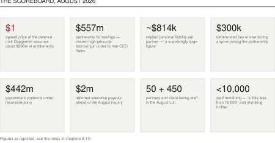

# Chapter 13 — Epilogue: The Fire Sale

*Status: draft v0.2*

Every chapter of this book has described a falling firm: the breach, the resignations, the surveillance, the client exodus, the probes. This chapter is about what happens after the fall — the agreed sale of KPMG's defence unit to Capgemini for the token sum of $1, the scramble by government agencies to contemplate life without KPMG, and the question of what remains of the firm when the crisis is over.

The $1 deal is the most brutal symbol of the affair. A business unit that had been worth hundreds of millions of dollars — KPMG's defence and national-security consulting practice, a crown jewel of the firm's government work — was to be transferred for a dollar, with the purchaser taking on the unit's liabilities. The price was not a valuation; it was a disposal. KPMG was paying to be rid of a business that had become unsellable at any real price, and that had become a liability to the firm's survival.

## Vultures circling

The Australian's reporting captured the mood of the market: "Vultures circling embattled KPMG: $1 offer to buy defence unit." The metaphor was apt. The collapse of a big four firm's reputation is not an event but a process, and in that process the firm's assets become prey. The defence unit — a practice built on security clearances, long-term government relationships, and specialised expertise — was the most valuable thing KPMG still owned, and the most compromised. Its clients were government agencies that were, at the same moment, being told by their own ministers that KPMG was no longer acceptable.

The $1 offer was made by Capgemini, the French technology and consulting giant, which saw in KPMG's misfortune an opportunity to acquire a defence-consulting capability at a price no commercial negotiation could otherwise have produced. The deal's terms — reported as $1 plus the assumption of around $200m in entitlements and liabilities — made the transaction a transfer of the unit's obligations to Capgemini in exchange for the unit's staff and contracts.

## The PJC defence scrutiny

The sale could not proceed without government scrutiny, and the government's scrutiny came through the parliamentary committee — the same committee, chaired by Senator Deborah O'Neill, that had driven the KPMG hearings. The committee examined whether the sale of a defence-consulting unit by a firm under investigation was in the national interest. The questions were pointed: would Capgemini inherit KPMG's problems? Would the government be contracting with the same people, under a different brand, who had been responsible for the scandal? And was the $1 price a genuine transaction or a way for KPMG to escape liability?

The PJC defence scrutiny framed the sale as a test of whether the government's own procurement could distinguish between the firm that had failed and the capabilities that might still be needed. The answers, at the time of writing, were unresolved.

## Life after KPMG

For the agencies that had relied on KPMG, the sale was the beginning of an awkward transition. "Agencies forced to contemplate life after KPMG," reported The Mandarin. The firm had embedded its people in government agencies across defence, finance, and infrastructure. The collapse of the firm's reputation forced a re-examination of contracts that had been negotiated over years, and a scramble to find replacement providers — in a market where the other big four firms were also under scrutiny.

The wider question was not whether the agencies would survive without KPMG, but what the exit of a major provider meant for the public sector's relationship with the consulting industry as a whole. The Treasury review of big four "policy problems," the states' bans, and the Commonwealth's freeze had already signalled that the government's dependence on the big four was ending. The KPMG fire sale was the first concrete demonstration of what that ending looked like: assets sold for a dollar, agencies scrambling, and a firm's decades of government work reduced to a transfer of liabilities.

## The exodus ahead of the hearing

The fire sale of assets was matched by a fire sale of people. In the days before the parliamentary hearing of 14 August 2026, KPMG's senior ranks thinned again. On 11 August, The Australian reported that the firm's general counsel, Louise Capon, and its head of human resources, Dorothy Hisgrove, were stepping down suddenly — Capon having overseen the internal investigation the committee was still demanding. The AFR tied the pair's departures to the coming Senate inquiry, and Accounting Times counted two more senior executives departing; hcamag set the HR chief's exit in the context of a wider "leadership exodus."

The scale of the cull became clear after the hearing. On 19 August, The Australian reported that KPMG had begun its "brutal cull" — "conversations" with 50 partners that week, with 450 client-facing staff expected to be axed the following week, confirmed by chief executive John Sams in a partner email that "no final decision had been made on staff numbers." In a cruel twist, none of those expected to go would be from the audit or tax teams — "it needs them on deck to retain clients" — and the same article disclosed that the whistleblower's executive payouts, reported separately, had reached $2m apiece ahead of the inquiry. The firm that had begun the year with its leadership intact went into its Canberra reckoning with its legal, human-resources and operational ranks depleted — and with the payout figures themselves entering the public record as evidence of what the firm's discretion had cost.

The cull sat on top of a financial squeeze that the scandal had made plain. The Australian reported on 19 August that KPMG Australia was carrying borrowings of $557 million — "record high personal borrowings accrued under former chief executive Andrew Yates" — and that the revenue cliff from the scandal landed on top of that debt, forcing the firm to go "cap in hand to KPMG International seeking financing." Clients and government departments were reconsidering some $442 million of contracts with the firm; the Australian Financial Review reported the debt figure equates to roughly $814,000 of personal liability per partner, "a surprisingly large figure" in a firm built of people rather than plant.

## The client exodus becomes a rout

The fire sale was the visible end of a commercial collapse that had been running for months. In September, IAG became the latest major client to leave: "Insurance giant IAG dumps KPMG as auditor after 26 years amid scandal" (The Australian, 18 September), with the AFR counting the $11.6m audit fee that walked out with it. Then, in the first days of October, the exodus reached the summit of Australian audit: ANZ terminated a 57-year relationship — "ANZ dumps KPMG as auditor after 57 years" (AFR); "ANZ to Drop Scandal-Hit KPMG Australia as Auditor After 57 Years" (Bloomberg) — and opened a tender for one of the most prestigious audit mandates in the country. A "big bank dumps scandal-hit audit firm after 57 years," the newswires agreed; the AAP wire carried it nationally.

The exodus was not only commercial. It was reputational arithmetic: every client that stayed was a client that might be asked, at its own annual meeting, why it had stayed. The AFR's October ledger — "Banned and bleeding: The growing cost of the KPMG audit leaks scandal" — put a price on the accumulating departures, and by late October the AFR could report that "KPMG chiefs left with millions despite being docked $1.2m over scandal": the partners who presided over the exodus had been penalised in sums that read, against the revenue lost, as rounding errors.

## The bailout

By the first week of October, the financial squeeze had become a capital question. The AFR reported that KPMG Australia was seeking up to $100m in emergency loans from its global firm network — "KPMG seeks up to $100m in emergency loans from global firm network" (4 October) — and the SMH translated the request into plain language: "KPMG Australia going cap in hand for $100m in loans." City AM called it what it was: "KPMG Australia seeks $100m bailout from parent group after scandal." The AFR's analysis asked whether the Australian firm "might have a case for a bailout from global HQ" — the partnership that had spent decades marketing its independence now dependent on the parent's balance sheet.

The bailout request sat alongside the firm's own governance reset. In October, big4news reported that KPMG Australia had announced a new Integrity Office as part of expanding governance reforms, and the AFR reported that KPMG had trimmed its senior partner ranks to cut costs. The firm that had resisted external oversight for a century was, in its ninth month of crisis, building internal oversight and selling assets to survive. Whether the Integrity Office was reform or rebranding was, at the time of writing, an open question — but its creation was itself an admission that the structures that had failed had to be seen to change.

## The reshuffle

In November, the firm's leadership churn continued. big4news reported that KPMG Australia had reshuffled its leadership "as another 400 jobs face axe" — the second mass-redundancy round of the spring — while Accounting Times reported the firm was "tight-lipped on reported 400 job cuts." Human Resources Director counted "up to 400 KPMG roles to be cut as scandal fallout continues." The AFR's column from the same week — "Professional Life: Allegations of intimidation, derailment, and misleading parliament" — showed that the scandal's political dimension had not closed with the hearings. And The Australian's society pages noted, in the register only society pages can, that a KPMG partner's "lavish reno" was proceeding amid the job cuts — the discord between the partnership's private comfort and its public reckoning preserved for the epilogue's tone.

## What remains of KPMG Australia

The agreed sale of the defence unit was one disposal among several that followed the scandal. Reporting examined the future of the firm's other practices — the insolvency unit, the advisory work, the audit practice itself — as the firm's clients and partners departed. The question "what remains of KPMG Australia" had two answers, neither comforting. The first was the firm that would continue to operate: a smaller, leaner KPMG, stripped of its most sensitive government work, rebuilding a client base that had largely left. The second was the partnership that had caused the scandal, protected from its consequences by the liability shield and the privilege that kept its records private.

The epilogue of the KPMG affair, when it is finally written, will describe the firms that inherit the work, the partners who leave and start again, and the whistleblowers who — as this book goes to press — wait to see whether the system that failed them is reformed or merely rebranded. The $1 deal was the market's verdict on KPMG's reputation. The reform of the profession that allowed the scandal to happen is the verdict that is still being written.

The post-hearing commentary had already begun to widen the lens. The AFR's verdicts were twofold: "KPMG is radioactive. But probe also exposes clubby corporate Australia" — the scandal was not one firm's alone but also the story of the banks, law firms and clients around it — and "KPMG needs more than another apology." The hearing had shown how much of the scandal sat outside KPMG's walls. The question for this epilogue is whether the reckoning stops at those walls too.

## Sources & notes

- Research: `writing/notes/ch13_epilogue_the_fire_sale.md`; `research/evidence_map.md`
- Key reported items: "Vultures circling embattled KPMG: $1 offer to buy defence unit" (The Australian); "Agencies forced to contemplate life after KPMG" (The Mandarin); Capgemini deal terms ($1 + ~$200m entitlements); PJC defence scrutiny
- August 2026: "KPMG axes 500 partners and staff after audit scandal" / "KPMG axes 500 staff, spares audit culprits" (The Australian, 19 Aug 2026); "KPMG begins brutal 500 jobs cull" (The Australian, 19 Aug 2026); GC Capon + HR Hisgrove step down (The Australian "Louise Capon quits", 11 Aug 2026); $557m borrowings / $814,000-per-partner liability / "record high personal borrowings under Yates" / $442m contracts at risk / "cap in hand to KPMG International" (The Australian, 19 Aug 2026)
- September–November 2026: IAG dumps KPMG after 26 years / $11.6m audit (The Australian + AFR, 18 Sep 2026); ANZ dumps KPMG after 57 years (AFR, Bloomberg, SMH/The Age, AAP, 1–2 Oct 2026); "Banned and bleeding: The growing cost of the KPMG audit leaks scandal" (AFR, 28 Oct 2026); "KPMG chiefs left with millions despite being docked $1.2m over scandal" (AFR, 30 Oct 2026); $100m emergency loans / bailout from global HQ (AFR + SMH, 4–5 Oct 2026; City AM, 6 Oct 2026); new Integrity Office (big4news, 9 Oct 2026); second 400-role cut and leadership reshuffle (big4news, 8 Nov 2026; HRD, 2 Nov 2026; AFR "400 more roles as government ban bites", 1 Nov 2026; Accounting Times "tight-lipped", 3 Nov 2026)

## Open questions

- Final terms and completion of the Capgemini transaction (Tier 4 gap 4.4)
- Whether the 50-partner/450-staff cull extends beyond the August round, and how many partners accept exit packages
- The precise financial stress signal: whether KPMG breaches its NAB/DBS revenue covenants and what International's financing conditions are
- What happens to KPMG's other practices — insolvency unit (Kroll interest reported), advisory, audit
- Whether the PJC approves or blocks the defence sale, and on what conditions
- The fate of the firm's remaining government work once the February 2027 federal ban expires — and whether any of it returns
- Whether the Integrity Office is given independence and powers, or remains an internal communications function
- Who wins the ANZ audit tender, and what the mandate's loss does to the remaining audit practice's economics